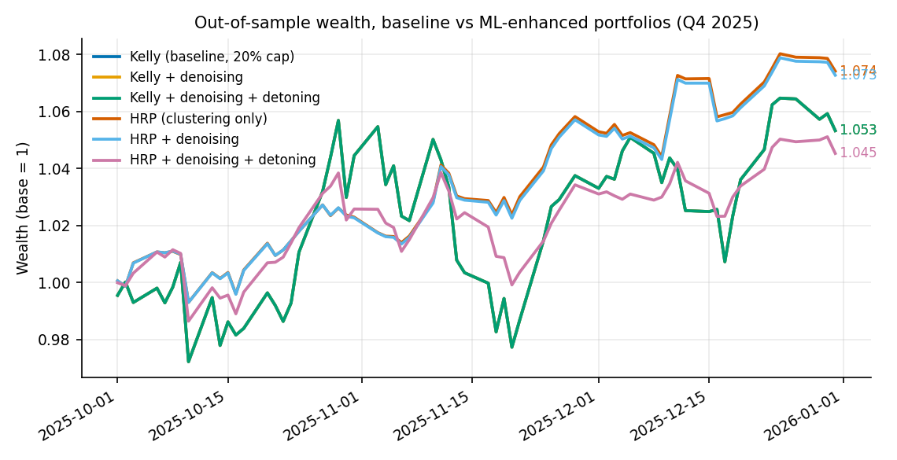
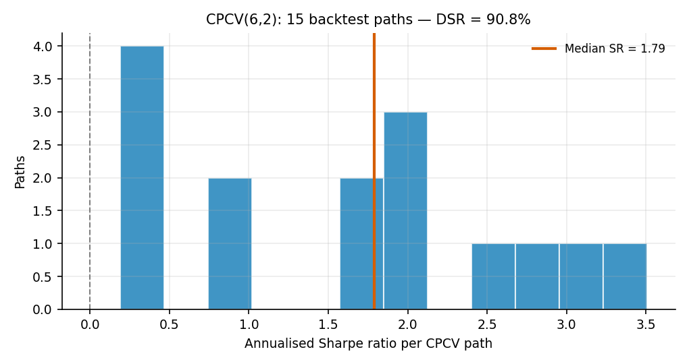
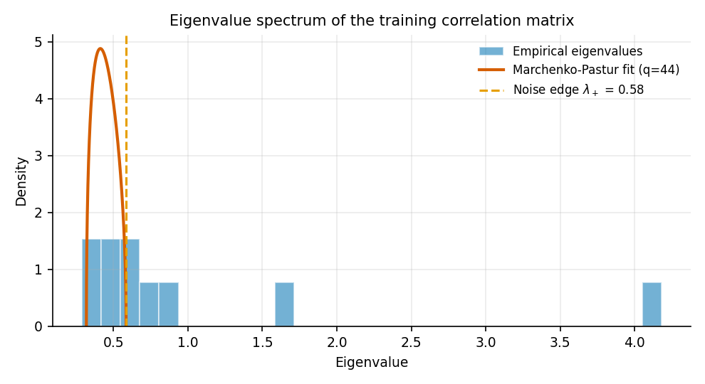

# Kelly portfolio construction with denoising, detoning and HRP

How much do machine-learning techniques improve a Kelly-based equity portfolio once the backtest is done properly? This project builds the Kelly-optimal portfolio on ten US large caps, then tests four enhancements: a concentration cap, Marchenko-Pastur denoising, detoning and Hierarchical Risk Parity. Everything is estimated on 21 months of data and evaluated out of sample, with purged cross-validation and a Deflated Sharpe Ratio to check that the results are not an artefact of one lucky split.

**Universe:** AAPL, MSFT, GOOGL, AMZN, NVDA, META, JPM, JNJ, V, XOM
**Training window:** Jan 2024 to Sep 2025 (437 sessions) | **Test window:** Q4 2025 (64 sessions)

## Key findings

1. **Unconstrained Kelly is unusable.** On 21 months of data it asks for about 32x gross leverage, driven by estimation error rather than signal. A 20% single-name cap turns it into a five-stock book (GOOGL, AMZN, NVDA, META, JPM) that returned 5.3% in Q4 2025 with a Sharpe ratio of 0.91.
2. **Scaling Kelly changes risk, not quality.** Half-, full and double-Kelly have the same Sharpe; return, volatility, drawdown and CVaR scale linearly with the multiplier.
3. **One backtest is not evidence.** Across 15 combinatorial purged cross-validation (CPCV) paths, the Sharpe ratio of the capped Kelly portfolio ranges from 0.24 (5th percentile) to 3.16 (95th). The Deflated Sharpe Ratio, which corrects for the number of strategies tried, is 0.91.
4. **Denoising works where it should.** It cuts the gross exposure of unconstrained Kelly from 32.2x to 26.1x and the condition number of the correlation matrix from 14.6 to 10.2. Under the 20% cap the cap is the binding regulariser, so the constrained weights do not move.
5. **HRP wins this quarter on risk-adjusted terms.** Sharpe 2.61 versus 0.91 for capped Kelly, with a maximum drawdown of 1.8% versus 7.5%. Detoning hurt HRP over this particular window, which is why the CPCV distribution, not one quarter, should drive the choice.

### Out-of-sample results, Q4 2025

| Portfolio | Cum. return | Ann. vol | Sharpe | Sortino | Max drawdown | CVaR 95% |
|---|---|---|---|---|---|---|
| Kelly (20% cap) | 5.33% | 20.35% | 0.91 | 1.36 | -7.52% | -2.61% |
| Kelly + denoising | 5.33% | 20.35% | 0.91 | 1.36 | -7.52% | -2.61% |
| Kelly + denoising + detoning | 5.33% | 20.35% | 0.91 | 1.36 | -7.52% | -2.61% |
| HRP | 7.41% | 9.42% | 2.61 | 4.22 | -1.77% | -1.11% |
| HRP + denoising | 7.27% | 9.39% | 2.56 | 4.14 | -1.78% | -1.11% |
| HRP + denoising + detoning | 4.53% | 10.71% | 1.31 | 1.67 | -3.79% | -1.47% |



## Methods

| Step | What it does |
|---|---|
| Kelly optimisation | Continuous-time Kelly, w* = Σ⁻¹(μ - r_f), unconstrained and with a 20% long-only cap |
| Leverage scaling | Half-, full and double-Kelly, uninvested cash and borrowing at r_f |
| Purged K-fold | 5 folds with purging and a 5-day embargo to stop serial-correlation leakage |
| CPCV | Combinatorial purged cross-validation (N = 6, k = 2, 15 backtest paths) |
| Deflated Sharpe Ratio | Adjusts the best Sharpe for multiple testing, skewness and kurtosis |
| Denoising | Marchenko-Pastur fit, noise eigenvalues replaced by their average |
| Detoning | Removal of the market (first) eigen-component from the correlation matrix |
| HRP | Hierarchical clustering, quasi-diagonalisation and recursive bisection |




## How to run

```bash
pip install -r requirements.txt
jupyter notebook kelly_hrp_portfolio.ipynb
```

The notebook tries to download prices from Yahoo Finance. Without network access it falls back on `data/prices_real.csv`, a snapshot of daily dividend- and split-adjusted closes downloaded on 28 August 2026, so results are reproducible offline.

## Repository structure

```
kelly_hrp_portfolio.ipynb   full analysis, with outputs
data/prices_real.csv        price snapshot used for the results above
figures/                    charts produced by the notebook
requirements.txt
```

## Credits

Group project for MScFE 652 Portfolio Management at WorldQuant University (2026), by Blairio Yetgang, Kudakwashe Lewis Waneta and Sheng Xu.

## References

- Bailey, D. and López de Prado, M. (2014). The Deflated Sharpe Ratio. *Journal of Portfolio Management*.
- López de Prado, M. (2016). Building Diversified Portfolios that Outperform Out of Sample. *Journal of Portfolio Management*.
- López de Prado, M. (2018). *Advances in Financial Machine Learning*. Wiley.
- Thorp, E. (2006). The Kelly Criterion in Blackjack, Sports Betting and the Stock Market. *Handbook of Asset and Liability Management*.
